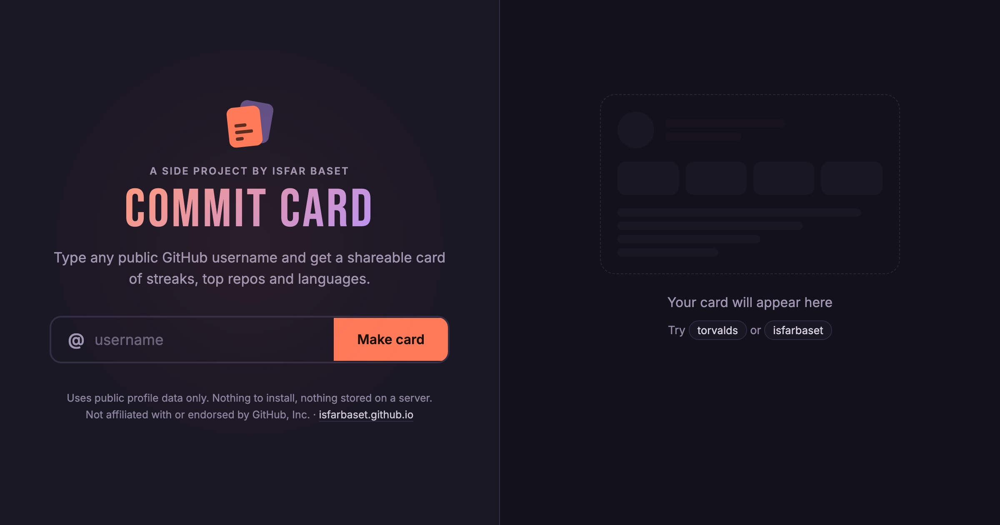

# Commit Card

A side project by Isfar Baset. Type any public GitHub username and get a downloadable stats card you can share on LinkedIn, add to your portfolio, or post anywhere.

Not affiliated with or endorsed by GitHub, Inc. The page uses no GitHub logos or brand colors on purpose, so it can't be mistaken for a GitHub page.

**Live:** [isfarbaset.github.io/github-insights](https://isfarbaset.github.io/github-insights/)



## Features

- Lifetime stats: repos, stars, followers, forks, commits, PRs, issues
- Longest and current daily streaks
- Developer personality badge and peak coding time
- Top repositories bar chart
- Monthly, day-of-week, and time-of-day activity breakdowns
- Top languages with color-coded bar
- Fun facts
- Download as high-res PNG
- One-click LinkedIn sharing

## Rate Limits

The page talks to GitHub's public API anonymously, which allows 60 requests per hour per visitor. If you hit the limit, the card shows what it can and the rest comes back within the hour. The page never asks for a credential of any kind.

## Run Locally

```bash
git clone https://github.com/isfarbaset/github-insights.git
cd github-insights
python3 -m http.server 8090
# Open http://localhost:8090
```

## Deploy

Served from the `docs/` folder via GitHub Pages. After making changes:

```bash
cp index.html card.css card.js docs/
git add -A && git commit -m "Update site" && git push
```

## License

MIT
